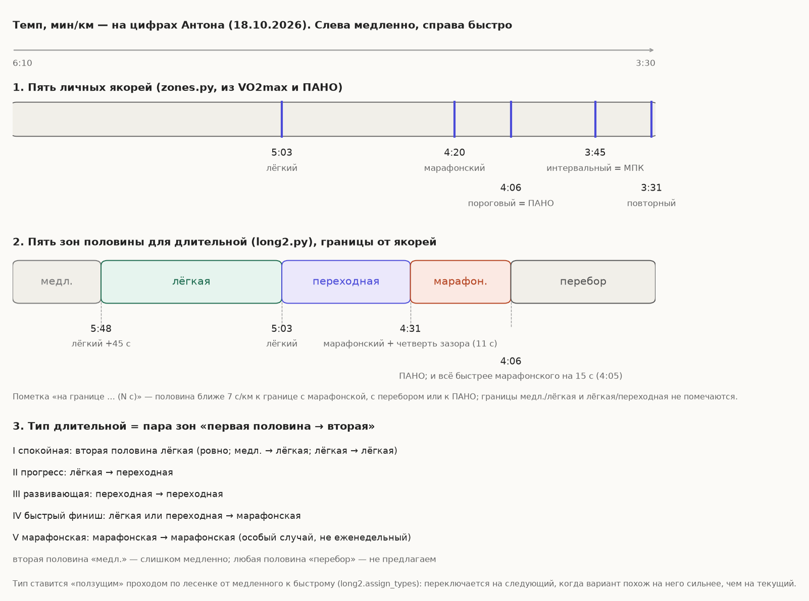
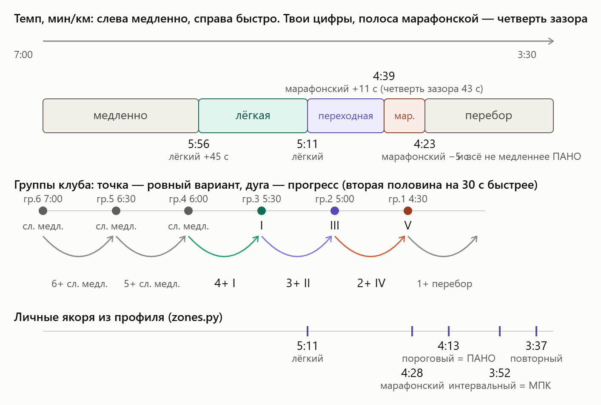

# INDEX — вся документация DoDick в одном месте

Начинать любую задачу отсюда. Если файл устарел — так и помечено; исправлять пометку при обновлении файла.

## Проверено
- [DB_SCHEMA.md](DB_SCHEMA.md) — база: где лежит, таблицы и поля, какая функция куда ходит. Пополняется по ходу задач. (с 19.09.2026)
- [CHANGELOG.md](CHANGELOG.md) — история версий.
- [ANCHORS.md](ANCHORS.md) — якоря зон (VO2max / порог), приоритеты «вручную / из систем», лесенка, кто что пишет, история решений и открытые задачи. (29.09.2026, по коду 0.32.0)
- [PROCESS_MAP.md](PROCESS_MAP.md) — ⚠️ не обновлялся с 07.08.2026, после этого многое поменялось.
- [PROJECT_CONTEXT.md](PROJECT_CONTEXT.md) — ⚠️ не обновлялся с 07.08.2026.

## Есть в папке, содержимое и свежесть не проверены
- [CLAUDE.md](CLAUDE.md)
- [MAP.md](MAP.md)
- [FUNCTIONS.md](FUNCTIONS.md)
- [OPS_CHEATSHEET.md](OPS_CHEATSHEET.md)
- [RECOMMENDATION_ENGINE.md](RECOMMENDATION_ENGINE.md)
- [DATA_NORMALIZER_SPEC.md](DATA_NORMALIZER_SPEC.md)
- [ROADMAP.md](ROADMAP.md)
- [IDEAS_BACKLOG.md](IDEAS_BACKLOG.md)

## Разбор тренировки (/report) — кратко (19.09.2026)
- Пакет данных: `src/ai_package.py`, `build_package`; промт — константа `PROMPT` там же.
- Порядок блоков: СПОРТСМЕН → ЦЕЛЬ И СУТЬ → ГРУППЫ → РЕКОМЕНДАЦИЯ С ВЕЧЕРА → ПЛАН → ФАКТ → САМОЧУВСТВИЕ (утро дня тренировки).
- Посмотреть промт целиком без вызова ИИ: `/report_p 0918` (только админ; то же `/report data`).
- Лонг (05.10.2026): `/report_long` — свой обработчик `bot.cmd_report_long`, свой пакет, промт `PROMPT_LONG`, карточка и графики в `src/ai_package_long.py`. Интервалы — `bot.cmd_report` и `src/ai_package.py`.
- **Правило:** у интервалов и лонга свои копии (`build_report_card`, `build_charts_stacked`, `build_charts`, сборщик пакета) и свои обработчики; меняя подпись одной — вторую не трогать. Общая только отправка (`_report_text_chunks`, `_report_ai_chunks`, `_report_send` в `bot.py`). После правок интервального разбора проверять `/report_long s`.

## Лонг2 — рекомендация длительной через ИИ (в бою с 0.47.3)
- `/long`, кнопка «Long Run», `/l_user`, субботняя рассылка — `src/long2.py` (`PROMPT_LONG2`, `build_long2_package`), `bot.LONG_ENGINE = "long2"`; откат `"long1"` — формула `claude_advisor.recommend_long`. Админ: `/long2` (`p` — промт и данные, `u` — выбрать, `<id>`, `all [N]` — теневой прогон).
-  — [docs/long2_zones.png](docs/long2_zones.png): якоря → пять зон половины → тип по паре зон, на цифрах Антона от 18.10.2026 (лёгкий 5:03, марафонский 4:20, ПАНО 4:06). Марафонская полоса сверху — четверть зазора лёгкий−марафонский, перебор — быстрее марафонского на 15 с или не медленнее ПАНО. Перерисовать: `python scripts/draw_long2_zones.py` из корня (якоря и дата — константы в начале скрипта). 
-  — [docs/long2_ladder.png](docs/long2_ladder.png): как варианты лесенки (гр.6 … гр.1, ровно и прогресс) ложатся на зоны и получают типы I–V, «слишком медленно», «перебор». Схема от начала октября: якоря на ней 5:11 / 4:28 / 4:13 (сейчас 5:03 / 4:20 / 4:06) и перебор от −5 с (сейчас −15 с); принцип раскладки верный. Функции: `long2.half_zone`, `mar_band`, `zone_border_note` (пометка «на границе» при зазоре ≤7 с, только к марафонской/перебору/порогу), `assign_types` («ползущий» проход по лесенке).

- [GARMIN_WORKOUT_JSON.md](GARMIN_WORKOUT_JSON.md) — памятка по JSON эталона Garmin: id условий и целей шага, где Garmin молча теряет значения (22.09.2026, из чужого репозитория, у нас не проверялось).

## Схема цикла «стадион» (19.09.2026)
- [scripts/cycle_media/README.md](scripts/cycle_media/README.md) — где схема на сайте, видео для Telegram и BotFather, как пересобрать.
